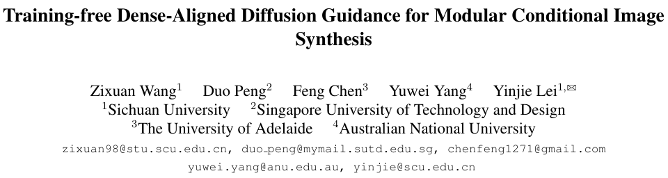

# Training-free Dense-Aligned Diffusion Guidance for Modular Conditional Image Synthesis

This is the code repository related to [Training-free Dense-Aligned Diffusion Guidance for Modular Conditional Image Synthesis](https://openaccess.thecvf.com/content/CVPR2025/papers/Wang_Training-free_Dense-Aligned_Diffusion_Guidance_for_Modular_Conditional_Image_Synthesis_CVPR_2025_paper.pdf) (CVPR 2025, Poster) in PyTorch implementation.




## Citation

If it is helpful to your research, please cite our paper as follows:

```bibtex
@inproceedings{wang2025training,
    title={Training-free dense-aligned diffusion guidance for modular conditional image synthesis},
    author={Wang, Zixuan and Peng, Duo and Chen, Feng and Yang, Yuwei and Lei, Yinjie},
    booktitle={Proceedings of the Computer Vision and Pattern Recognition Conference (CVPR)},
    pages={13135--13145},
    year={2025}
}
```
